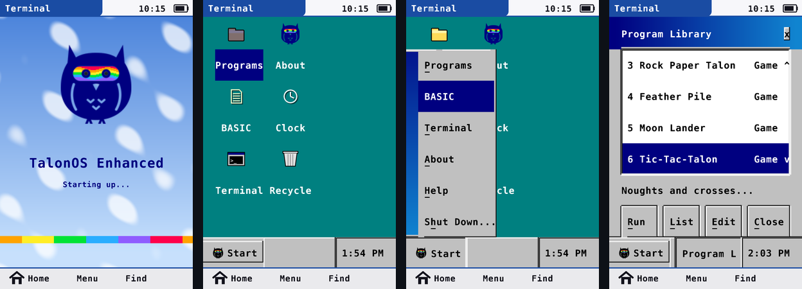
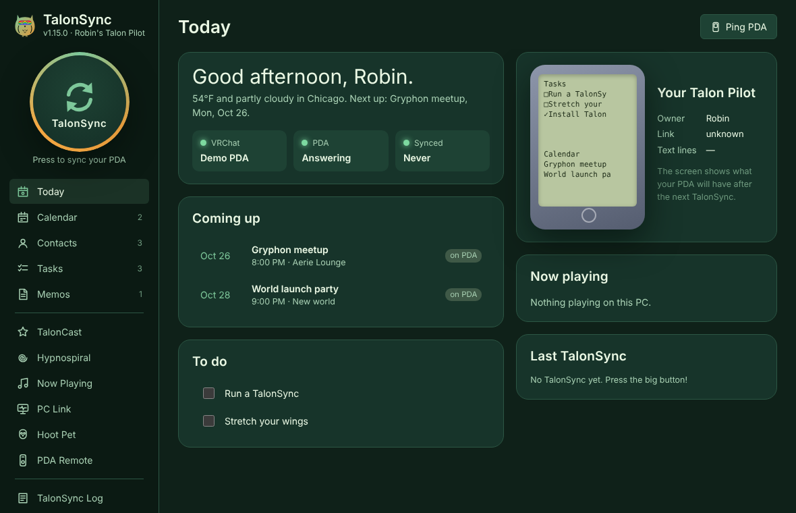
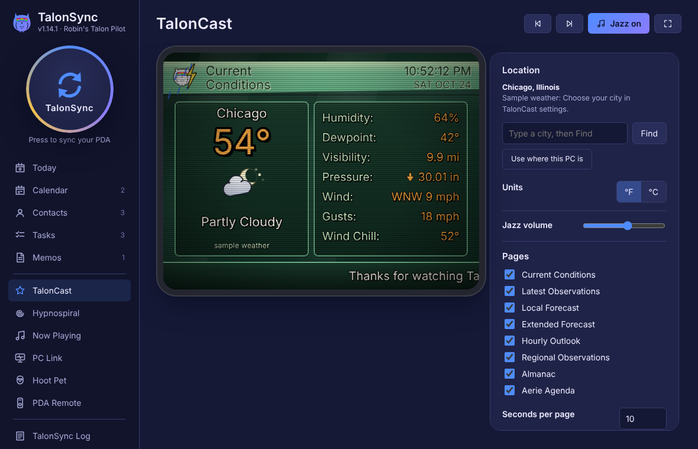
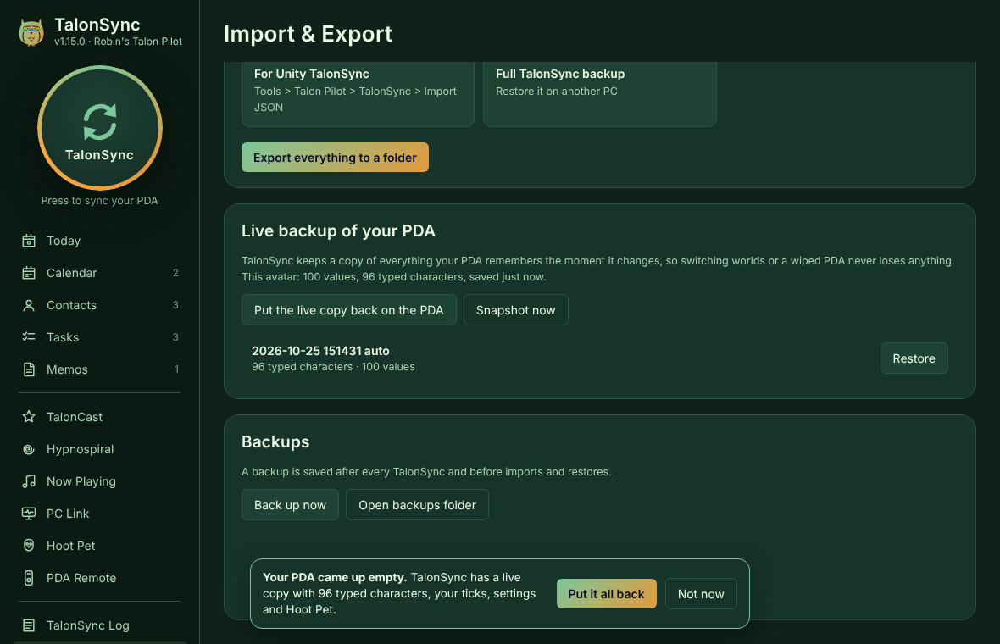
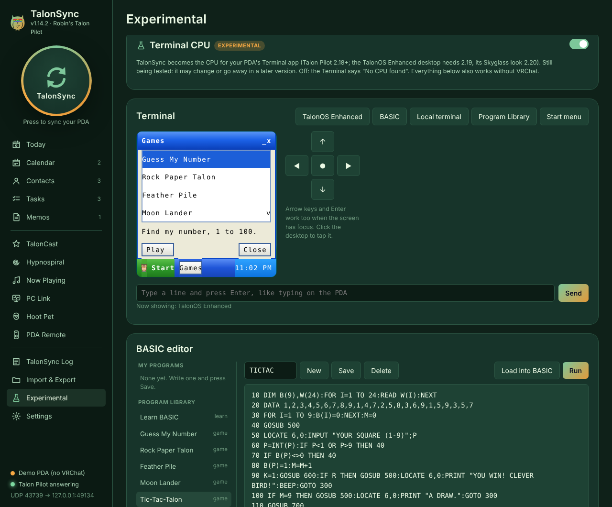
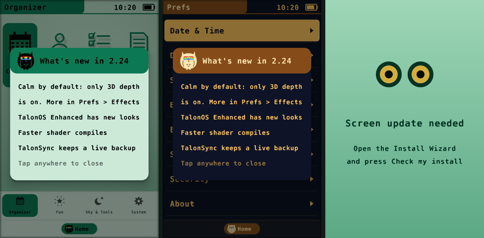
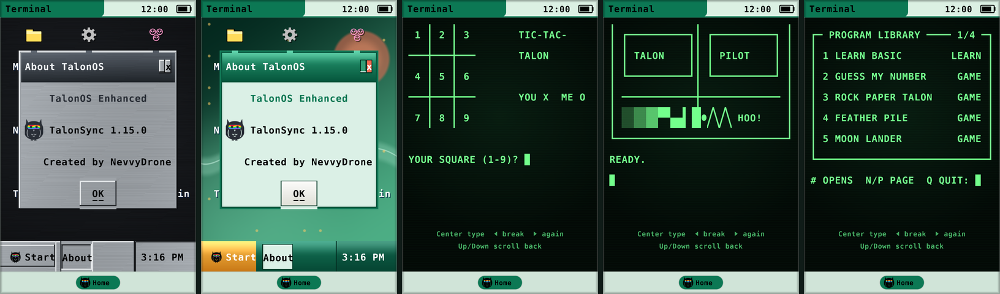

# TalonSync

Created by NevvyDrone · [nevvydrone.com](https://nevvydrone.com)

TalonSync is the PC companion for the Talon Pilot VRChat PDA. It syncs your PDA with your PC over OSC and plays the TalonSync animation on the PDA in game. It also includes TalonCast, a cable-weather channel with a smooth jazz loop, and it can be the CPU for the PDA's Terminal: **TalonOS Enhanced**, a small windowed OS that runs on your PC and shows on the PDA in VRChat.

## What's inside

- **TalonSync:** two-way sync of your PDA's calendar, contacts, tasks, memos and settings with your PC, plus backups and
  imports and exports in everyday formats (vCard, iCalendar, CSV, Markdown).
- **Live backup** *(1.15)*: TalonSync keeps a copy of everything your PDA remembers the moment it changes. Switching
  worlds never loses anything, and if your PDA ever comes up empty, one tap ("Put it all back") restores it. Snapshots
  of the last few versions are kept too.
- **TalonOS Enhanced** *(experimental)*: a small windowed OS drawn on the PDA's screen, in a **Classic** brushed-aluminium look or
  **Skyglass**, mint glass in NevvyDrone's owl colours. Windows, a taskbar, a Start menu and **Control Panel**, **Notepad**, **Calculator**, **My Files**
  with a **Recycle Bin**, **Date/Time** and **System Monitor**. Tap it with your finger or stylus in VRChat, or use the
  PDA's buttons.
- **Games:** Guess My Number, Rock Paper Talon, Feather Pile, Moon Lander, Tic-Tac-Talon, Featherword, Aerie Keeper,
  Talon Dice, Find the Mouse, Ponder the Owl and Math Drill, as windowed apps you play by tapping (best scores kept).
- **BASIC Programs:** the same games written in BASIC, plus Learn BASIC and four demos, to run, read and change.
- **Make your own apps:** windowed BASIC apps and file I/O, and opt-in Python plugins
  ([the SDK guide](docs/TalonOS_SDK.md)).
- **Talon Enhanced BASIC:** a line-numbered home-computer BASIC with line graphics (`BOX`, `LINE`, `LOCATE`), saved
  programs and a local terminal with its own commands.
- **TalonCast:** a retro cable-weather channel (free weather from Open-Meteo, no account) with smooth jazz, on your
  PC and on the PDA.
- **Now Playing, PC Link, Desktop click:** the song from your PC, PC stats and messages on the PDA, and a click-to-tap
  mode for VRChat desktop players.

| Today | TalonCast |
|---|---|
|  |  |
| **Live backup** *(1.15)* | **Experimental: TalonOS Enhanced and BASIC** |
|  |  |

### New in Talon Pilot 2.24 "Launch Ready"

- **What's new card** the first time you switch on after an update.
- **Check my install** in the Install Wizard builds every screen program with Unity's own compiler and explains
  anything wrong; if the screen can't compile, the **safe screen** (right) shows instead of magenta, in the editor and
  on upload.
- **Calm by default:** only 3D depth is on; Holo foil, glints, ripples, idle glow and motes wait in Prefs › Effects.
- **Faster shader compiles,** and TalonSync's **live backup** keeps your PDA safe across world switches.

## Need help?

Open `Documentation/Talon_Pilot_Help.html` for quick fixes. Still stuck? Press **Copy support info**
(Install Wizard footer, or Tools > Talon Pilot > Copy Support Info; in TalonSync: Settings > Connection) and
email it with your question to **[nevvydrone@nevvydrone.com](mailto:nevvydrone@nevvydrone.com)**.

## Licence

TalonSync (including Talon Enhanced BASIC and TalonOS Enhanced) is © 2026 NevvyDrone and licensed under the
[PolyForm Noncommercial License 1.0.0](LICENSE.md). You may use, change and share it, and build on it, for any
**non-commercial** purpose; selling it or using it commercially needs NevvyDrone's permission (ask at nevvydrone@nevvydrone.com). Contributions are welcome:
see [CONTRIBUTING.md](CONTRIBUTING.md).

The names Talon Pilot, TalonOS, TalonSync, TalonCast, Hoot-agotchi and Owl Oracle, and the owl logo, belong to
NevvyDrone; the licence doesn't cover them, so please give forks their own name. Talon Pilot itself (the Unity avatar
package) is sold separately under its own licence.

TalonSync.exe also contains open-source libraries by other people (the window, tray icon, OSCQuery and more), each
under its own licence: see [THIRD_PARTY_NOTICES.txt](THIRD_PARTY_NOTICES.txt).

## Get TalonSync

- **Ready to run (Windows):** the Talon Pilot download includes a prebuilt **`TalonSync.exe`**. Double-click it; nothing
  else to install.
- **Build it yourself:** everything needed to compile your own copy is here, and the source is on GitHub:
  [github.com/NevvyDrone/Talonsync](https://github.com/NevvyDrone/Talonsync). The steps are below.

### "Windows protected your PC"

TalonSync.exe isn't signed with a paid certificate, so Windows SmartScreen may warn you the first time. Click
**More info**, then **Run anyway**. Some antivirus programs also flag apps packaged from Python by mistake; if yours
quarantines TalonSync.exe, restore it and allow it, or run `Run TalonSync (without building).bat`, which runs the same
code straight from the readable source in this folder.

### Privacy

TalonSync runs on your PC and talks to VRChat over OSC on your own machine. Your tasks, memos, contacts, calendar and
the live backup stay in TalonSync's data folder. It only goes online for the TalonCast weather (Open-Meteo, no account)
and for features you switch on yourself (like Twitch messages or the optional Python plugins). No analytics, no
accounts, nothing sent to NevvyDrone.

### VRCFury and Modular Avatar

Talon Pilot installs with its own Install Wizard and works alongside VRCFury (tested on NevvyDrone's own
avatars). TalonSync doesn't care how the PDA was installed: it only needs VRChat's OSC switched on.

## Build the exe yourself (optional)

1. **Install Python** (3.13 or 3.14 recommended) from https://www.python.org/downloads/windows/. Tick **"Add python.exe to PATH"** during install. Any Python from 3.10.1 up works (3.13 or 3.14 are the safest for building the exe; 3.10.0 has a bug, so the bat skips it). If a brand-new Python is too new for the exe builder, `Run TalonSync (without building).bat` still runs the app.
2. **Double-click `Build TalonSync.bat`.** It:
   - makes a private `.venv`
   - installs what it needs
   - runs the self-tests
   - builds **`TalonSync.exe`** next to the bat
3. **Run `TalonSync.exe`.** It lives in the system tray (the owl), so closing the window keeps it running. Turn that off in Settings › Appearance & startup.

To run TalonSync without building, use `Run TalonSync (without building).bat` (after building once).

### Updating

The exe has its files baked in, so unzipping a new version does **not** change it.
1. Quit TalonSync: right-click the tray owl › **Quit**.
2. Unzip the new version over the old folder.
3. Double-click **`Build TalonSync.bat`** again.

The version number is under the TalonSync name, top left. If the exe is older than the files next to it, a yellow banner tells you to rebuild. If an old copy is still running in the tray when you start the new one, TalonSync asks to close it.

## PC Link (Talon Pilot 2.11+)

TalonSync feeds the PDA's **PC Link** app: heart rate, headset and controller battery (SteamVR, via `openvr`), CPU/GPU/RAM load and
temperatures (`psutil`; GPU needs `nvidia-smi`), messages, a music remote and a focus timer. Turn each part on or off on the PC Link page.

- **Heart rate:** any heart-rate app that sends the avatar parameter `HR` (or `HeartRateInt`) to VRChat. VRChat echoes it to TalonSync.
- **Messages:** calendar reminders, the Send box, Twitch @mentions, OSC `/talonpilot/message "title" "text"` to TalonSync's port, and
  (Linux) desktop notifications. Windows doesn't let ordinary programs read other apps' notifications.
- **Music remote:** media keys on Windows, MPRIS on Linux (`playerctl` or `gdbus`), Spotify/Music on macOS.
- **Twitch chat:** set your channel, then choose *Twitch chat* as the PDA ticker, or turn on mentions. Anonymous, read-only.
- PDA commands arrive on the expression parameter `TP/PC/Cmd` (1 play/pause, 2 next, 3 previous, 4 timer, 5 timer reset, 6 clear).

## Desktop click (Talon Pilot 2.12+, Windows)

Playing VRChat on desktop? Aim the dot in the middle of your screen at the parked PDA and hold the
**middle mouse button** to tap it. Pick another button (mouse side buttons, F-keys) or give
**Bring PDA in front** a button in Settings > Desktop mode. It only acts while the VRChat window is
in front, and it reads the button without hooking your mouse, so it can't add lag or eat clicks.

## Support info

Settings > Connection > **Copy support info** copies versions, the connection checks, your settings and
the last log lines (no records, location, Twitch channel or Windows user name). Paste it into your help request.

## Linux and macOS

TalonSync runs on Linux and macOS too. There's no exe there: a script sets it up and starts it.

- **Linux:** in a terminal, `cd` into the TalonSync folder and run `./Run\ TalonSync.sh` (or double-click it if your file manager runs scripts).
- **macOS:** double-click **`Run TalonSync.command`**. The first time, macOS may say it's from an unidentified developer: right-click it › **Open** › **Open**.

The first run makes a private `.venv`, installs what it needs and runs a quick self-test, which takes about a minute. After that it just starts. `--setup` reinstalls the packages.

**What's different from Windows**
- **The window:** on macOS it's a normal app window. On Linux, TalonSync opens in a Chrome/Chromium/Edge app window (or your browser) unless your desktop has GTK WebKit (`sudo apt install python3-gi gir1.2-webkit2-4.1`), or you run the script once with `--qt` for a Qt window. It works the same either way.
- **Now Playing:**
  - Linux reads your desktop's media controls (MPRIS): Spotify, Firefox, Chrome, VLC, mpv, Rhythmbox and the rest. It uses `playerctl` if you have it, otherwise `gdbus`, which almost every desktop has.
  - macOS reads Spotify and Apple Music. The first time, macOS asks whether TalonSync may control them: say OK.
  - "Player window titles" is Windows-only.
- **Start when I log in** (Settings › Appearance & startup) makes a Linux autostart entry (`~/.config/autostart/talonsync.desktop`) or a macOS login agent (`~/Library/LaunchAgents/com.talonsync.app.plist`).
- **The tray icon:** macOS has none, so closing the window quits TalonSync there.

**VRChat on Linux (Steam Proton)**
VRChat's OSC works under Proton exactly like on Windows: it talks to `127.0.0.1`, so just turn OSC on in game. If TalonSync says it's waiting for VRChat, VRChat's OSCQuery announcement probably isn't reaching Linux. Turn **OSCQuery off** in Settings › Connection so TalonSync uses the plain ports (it listens on 9001 and sends to 9000), then switch avatars once.

**macOS (VRChat on another PC)**
VRChat doesn't run on a Mac, but TalonSync on a Mac can sync with VRChat on a Windows PC on the same network:
1. On the Mac, in Settings › Connection, set **Listen on** to `0.0.0.0` and **VRChat address** to the PC's IP address, and turn OSCQuery off.
2. In Steam on the PC, set VRChat's launch options to `--osc=9000:MAC-IP:9001` (put the Mac's IP address in place of `MAC-IP`).
3. Allow UDP ports 9000 and 9001 through both firewalls.

## Set up VRChat

1. **Update your avatar.** Install or patch Talon Pilot **2.5** on it, with **PC link** on, then upload. Version 2.5 adds Now Playing, TalonCast and exact settings sync.
2. **Turn on OSC.** In VRChat, open the Action Menu › Options › OSC › **Enabled**.
3. **Fix a stale OSC config if needed.** If you used the avatar with OSC before updating, VRChat keeps an old OSC config for it. Use Settings › Connection › **Connection doctor** › **Fix**, then switch avatars once.

## TalonSync

Created by NevvyDrone · [nevvydrone.com](https://nevvydrone.com)

- **From the PC:** press the big **TalonSync** button (or Ctrl+H).
- **From the PDA:** tap TalonSync in game. TalonSync answers automatically.
- **What you see:**
  - **On the PDA:** it jumps to its TalonSync screen, the arrows spin, and the stage and progress update live. It chirps "TalonSync complete!" at the end.
  - **On the PC:** the TalonSync Progress window shows the same stages.
- **Conduits.** Each conduit can be set to:
  - **Synchronize:** a three-way merge, so edits on either side win.
  - **Desktop overwrites handheld**
  - **Handheld overwrites desktop**
  - **Do nothing**

  The conduits are settings, tasks, memos, calendar, contacts and the Hypno caption. Change them in Settings › TalonSync.
- **Conflicts.** For things changed on both sides you can keep the PC version, keep the PDA version, or keep both.
- **Backups.** A dated backup is saved after every TalonSync (Import & Export › Backups).
- **Live backup (1.15).** Between syncs, TalonSync keeps a live copy of everything the PDA remembers (typed lines,
  ticks, settings, the Hoot Pet, best scores) and offers to put it back if the PDA comes up empty after a world or
  avatar switch. Switch on **Put a wiped PDA back automatically** in Settings › Files & backups to skip the question.

## Files other apps open

| | Export | Import |
|---|---|---|
| Contacts | vCard (.vcf), CSV (Outlook headers) | vCard 2.1/3.0/4.0, Outlook or Google CSV |
| Calendar | iCalendar (.ics), CSV | .ics (Outlook, Google, Apple), CSV |
| Tasks | .ics (VTODO), Markdown checklist, CSV | the same |
| Memos | Markdown, CSV | Markdown, text, CSV |
| Everything | TalonSync backup, Unity TalonSync JSON | Unity TalonSync JSON |

- **Importing:** drag files onto Import & Export. Duplicates are skipped.
- **Automatic exports:** set an export folder and TalonSync writes every format after each TalonSync.
- **Watch folder:** set a watch folder and TalonSync imports anything you drop into it.

## TalonOS Enhanced and the Terminal (Talon Pilot 2.18+, desktop 2.19+, Skyglass 2.20+)

TalonOS Enhanced runs inside TalonSync; the PDA is its screen, touchscreen and buttons. TalonSync sends the screen as
30 x 8 cells over OSC (a character and a style each), and the PDA's shader draws the title bars, bevels, icons and
taskbar from them, so it adds no animator layers and nothing runs per frame. Taps come back from the PDA's touch grid
over OSC. On the desktop: tap anything, or Up/Down to move between controls, Center to press, Left to go back or close,
Right for the Start menu. Typed lines go into the box with the cursor; on the desktop, typing a program's name opens it.

The Start menu has Programs (BASIC Programs, BASIC, Terminal, My Files, Task Manager and your installed apps),
Accessories (Notepad, Calculator, Date/Time, System Monitor), Games, Documents (recent files), Settings (Control Panel,
Help, About), Run and Shut Down.

**A real little OS underneath (1.14):** a kernel with processes (Task Manager shows them and can end one; a crashing
app closes alone), an event bus, a settings registry, a clipboard and notifications; **TalonFS**, a file system with
`C:\Documents`, `C:\Programs`, `C:\Apps`, `C:\Recycled`, `C:\Temp` and a read-only `A:` disk of built-in programs, all
sandboxed inside TalonSync's data folder; My Files with folders, copy and paste; Open and Save As boxes.

**Write your own apps:** a BASIC program that uses `WINDOW` runs as a windowed app with buttons, text boxes, check
boxes and progress bars, and BASIC can read and write files (`OPEN #`, `PRINT #`, `INPUT #`). Python plugins work
too, but they're off until you allow them in Control Panel, and each one asks before it runs. The guide is
[docs/TalonOS_SDK.md](docs/TalonOS_SDK.md). Control Panel switches between the
**Classic** and **Skyglass** looks (Skyglass needs Talon Pilot 2.20), sets the clock, beeps and the start-up screen,
and chooses whether the desktop comes back when the PDA switches on. Settings and best scores are saved in
`talonos.json` in TalonSync's data folder, Notepad's notes in `Documents`, and deleted files go to `Recycled` until you
empty the Recycle Bin.

**Experimental, opt in:** open **Experimental** in the sidebar and switch on **Terminal CPU** first (it's off by default).
The same page mirrors the PDA's Terminal on your PC: type into it, press the PDA's buttons, click the TalonOS Enhanced desktop, and write, save, load and run BASIC programs in an editor (with the Program Library's programs to open and learn from). It all works without VRChat too.
TalonSync is then the CPU for the PDA's **Terminal** app. When the Terminal finds it, it asks what to start: **1** TalonOS Enhanced, a classic desktop with a Start menu, taskbar, icons and windows that you can tap or drive with the buttons, with the Program Library (games, demos and a BASIC tour you can run without knowing BASIC) inside, **2** Talon Enhanced BASIC, or **3** the local terminal with built-in commands (`HELP`, `TIME`, `DATE`, `CPU`, `UPTIME`, `FILES`, `ECHO`, `LIBRARY`, `BASIC`, `MENU`). `BYE` leaves BASIC. Type `TALONOS` (or `WIN`) anywhere to open the desktop. If you were using the desktop when the PDA switched off, it comes back when the PDA switches on again; choosing Shut Down or the menu from the desktop goes back to the start menu instead.
The screen draws real line graphics (Talon Pilot 2.18.2+): `BOX`, `LINE` and `LOCATE` in BASIC, and `CHR$(5)`-`CHR$(31)` for shades, blocks and box pieces.
Open Terminal on your PDA, press Center to type, Done to send. Type `HELP` for the commands. Programs you `SAVE` are kept in
the `Programs` folder inside TalonSync's data folder, and the program you're working on is kept between sessions.

## Now Playing

- **What it does:** TalonSync reads the song from Windows' media controls, which covers Spotify, YouTube in a browser, Apple Music, foobar2000, VLC and more. It shows the song on the PDA's Now Playing card on the TalonSync and Scope screens, with a progress bar.
- **Chatbox:** it can also post the song to your VRChat chatbox.
- **Messages:** you can send your PDA a short message from the Now Playing page.

## TalonCast

(Called TalonStar 4000 before TalonSync 1.14.1 and Talon Pilot 2.21; your settings carry over.)

- **On the PC:** pick your city in the TalonCast page and the pages cycle on their own:
  - Current Conditions, Latest Observations and Local Forecast
  - Extended Forecast and Hourly Outlook
  - Regional Observations, Almanac (sun and moon) and Aerie Agenda (your calendar)

  It has a crawl, an old-TV look, four color themes, full screen, and a **smooth jazz** loop. Weather is from Open-Meteo: free, with no account.
- **On the PDA:** open **TalonCast** on the launcher's first page. TalonSync sends it the weather.
  - Left/Right flip pages.
  - **Center** changes the jazz: **Off**, **Only I can hear it** (it plays in your ears only), or **Everyone nearby**. You can also set this from TalonSync.

## Settings, briefly

- **Connection:** ports, OSCQuery (on by default, so other OSC apps can run alongside), a **Demo PDA** to try everything without VRChat, and the connection doctor.
- **TalonSync:** auto-sync timer, sync on start, conflict rule, conduits, and the chirp.
- **Now Playing:** source, playback bar, swap lines, ALL CAPS, hide when paused, and the chatbox format.
- **TalonCast:** units, pages, seconds per page, look, animation level, CRT strength, crawl text and speed, clock format, jazz volume, and the PDA jazz mode.
- **Files & backups:** backups to keep, live backup and automatic restore, auto-export, watch folder, and start over.
- **Appearance & startup:**
  - Themes: Mint Owl (the default, in NevvyDrone's colours since 1.14.2), Aerie, Classic Desktop, Owl Night, Gryphon Gold, Daylight.
  - Accent color, compact lists, and animations.
  - Start with Windows, start in the tray, and close to the tray.
- **Advanced:** bus timing and retries, for laggy instances.

Your data lives in `%APPDATA%\TalonSync`. For a portable copy, put an empty `portable.txt` next to the exe.

## For the curious

The PDA's animator is the CPU. TalonSync talks to it through a pseudo-serial bus made of avatar parameters: address and data lines, a clock, and an acknowledge. The protocol is in `talonsync/protocol.py` and `Editor/TalonPilotAnimatorBus.cs`.

- `tests/test_fake_sync.py` syncs against a pretend PDA over real UDP.
- `tests/real_animator_sync.py` syncs against the real generated animator through a VRChat-like bridge.
